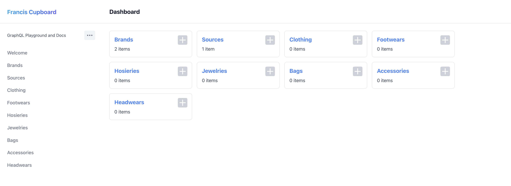

# Cupboard

Cupboard is a wardrobe inventory management system.



## Initial setup

Install dependencies and create the local environment file:

```sh
pnpm install
cp .env.example .env
```

Create the database from the committed migrations:

```sh
pnpm db:deploy
```

## Start the application

After completing the initial setup, start Keystone:

```sh
pnpm dev
```

The Admin UI is available at `http://localhost:3000`. 
This command uses `--no-db-push`, so it never creates or updates database tables automatically. 
Apply migrations first with `pnpm db:deploy`.

## Commands

| Command | Purpose |
| --- | --- |
| `pnpm build` | Generates Keystone schemas and builds the production Admin UI. It does not change database data. |
| `pnpm dev` | Starts Keystone locally without changing the database schema. |
| `pnpm db:migrate -- --name change_name` | Creates and applies a new development migration after a schema change. |
| `pnpm db:deploy` | Applies committed migrations to create or update database tables. |
