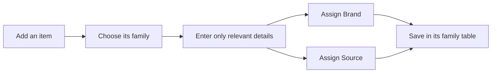
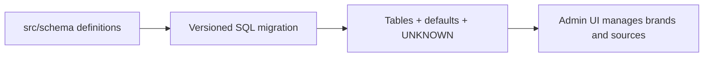

# How Cupboard works

Cupboard is a personal wardrobe inventory. 
Its purpose is to record what an item is, where it came from, and the information needed to find or compare it later.

## Structure of the data

An item belongs to one concrete family: clothing, footwear, hosiery, jewelry, a bag, an accessory, or headwear.
This prevents meaningless information: jewelry has a length, but not a clothing fit or warmth level.



Each family has its own database table. 
The table itself is the broad category, while `subType` describes the specific kind inside that family: for example, `Clothing → JEANS` or `Jewelry → EARRINGS`.

### Shared item information

All wardrobe families keep their own copy of the shared item information: name, brand, source, notes, image path, material, and whether maintenance is needed. 
Keeping these columns in each table makes every family usable on its own and avoids a large table full of irrelevant empty fields.

`Brand` and `Source` are lookup records, not enums. 
They are stored in the database because they can grow naturally as the wardrobe grows. 
The Admin UI can add a new brand or source without changing code.

Material, fit, warmth, size, and subtype are different: they are controlled application enums. 
Their allowed values live in `src/schema/enums/` so the application presents consistent choices and avoids spelling variants such as `blue jeans`, `Blue Jeans`, or `jeans` for the same kind of value.

### Unknown is a valid state

Not knowing a brand or source should not stop someone from recording an item. The first database migration creates these two permanent fallback records:

```text
Brand  id: 1, name: UNKNOWN
Source id: 1, name: UNKNOWN
```

Every wardrobe item defaults its `brand_id` and `source_id` to those records. 
Required enum fields also have sensible defaults: material is `UNKNOWN`, fit is `REGULAR`, warmth is `NORMAL`, and size is `ONE_SIZE`. 
Each family also has a valid initial subtype default.

### Database change story

`src/schema/` is the model definition that developers edit. 
Keystone turns it into a Prisma schema, and a migration turns that schema change into versioned SQL. 

Migrations own the tables, defaults, foreign keys, and the two `UNKNOWN` records.
The first migration creates the structure; a follow-up migration adds the two fallback lookup records for the already-initialized database. They are intentionally not recreated by application startup. Enums remain code in `src/schema/enums/`; they are never stored as lookup rows.

Developers change the TypeScript definitions in `src/schema/`; generated `schema.prisma`, `schema.graphql`, and `.keystone` files must not be edited manually. 
After a model change, create a migration with:

```sh
pnpm db:migrate -- --name describe_the_change
```

Review and commit the new migration with the TypeScript change. 
Apply committed migrations with `pnpm db:deploy`. Do not edit a migration that has already been applied; create a new migration instead.



### Where to find what

| Location | Why it exists |
| --- | --- |
| `src/schema/lists/` | Defines what each wardrobe family can store. |
| `src/schema/fields/` | Keeps common field rules consistent across families. |
| `src/schema/enums/` | Defines controlled choices and their defaults. |
| `migrations/` | Records permanent database structure changes. |
| `storage/wardrobe-images/` | Holds local image files for V1. |
