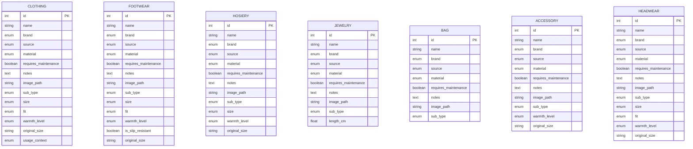

# Cupboard System — V1 Specification

**Status:** Work specification  
**Scope:** Wardrobe inventory only. Makeup and related are out of scope.

## 1. Design goals

- Keep the models understandable and small for the first version.
- Classify each item by its concrete kind, while keeping shared code reusable.
- Avoid attributes that have no meaning for a particular family: for example, jewelry has no clothing fit or warmth value.

## 2. Core modeling decision

The database has one table per concrete model:

`Clothing`, `Footwear`, `Hosiery`, `Jewelry`, `Bag`, `Accessory`, and `Headwear`.

The application may define a shared, non-persisted base class or interface (for example, `WardrobeItem`) for common behavior. 
Each concrete table stores its own copy of the common fields, such as name, brand, source, notes, and image path.

The table identifies the broad family, so there is no redundant `category` column. A family-specific `subtype` enum identifies the kind within that table. 
For example, `Clothing.subtype = JEANS` and `Jewelry.subtype = EARRINGS`.

## 3. Model families and subtype examples

| Model/table | Includes | Example subtype values |
|---|---|---|
| `Clothing` | Tops, shirts, blouses, pullovers, jackets, coats, pants, jeans, shorts, skirts, dresses, leggings, swimwear | `T_SHIRT`, `SHIRT`, `BLOUSE`, `TOP`, `PULLOVER`, `CARDIGAN`, `JACKET`, `COAT`, `TROUSERS`, `JEANS`, `LEGGINGS`, `SHORTS`, `SKIRT`, `DRESS`, `SWIMSUIT`, `BIKINI_TOP`, `BIKINI_BOTTOM` |
| `Footwear` | Shoes, boots, sandals, sneakers, heels, flats | `SNEAKERS`, `SPORT_SHOES`, `BOOTS`, `ANKLE_BOOTS`, `SANDALS`, `FLATS`, `HEELS`, `LOAFERS` |
| `Hosiery` | Socks, tights, stockings, knee-highs | `SOCKS`, `KNEE_HIGH_SOCKS`, `TIGHTS`, `STOCKINGS`, `LEG_WARMERS` |
| `Jewelry` | Earrings, necklaces, bracelets, anklets, rings, watches | `EARRINGS`, `NECKLACE`, `BRACELET`, `ANKLET`, `RING`, `WATCH`|
| `Bag` | Handbags, crossbody bags, totes, backpacks, clutches, and similar | `HANDBAG`, `CROSSBODY`, `SHOULDER_BAG`, `TOTE`, `BACKPACK`, `CLUTCH`, `BELT_BAG` |
| `Accessory` | Belts, scarves, gloves, sunglasses, and similar | `BELT`, `SCARF`, `GLOVES`, `SUNGLASSES`, `HAIR_ACCESSORY` |
| `Headwear` | Hats, caps, berets, beanies, sun hats | `BEANIE`, `BERET`, `CAP`, `HAT`, `SUN_HAT` |

These subtype lists are initial proposals, not an exhaustive inventory. Add a value when the wardrobe needs it; keep each subtype enum scoped to its model.

## 4. V1 fields

> Note: for DB columns snake_case is the rule, for the system though (coding), camelCase will be the norm.

### Common fields on each concrete model

| Field                  | Type/constraint                    | Notes                                                                                                |
|------------------------|------------------------------------|------------------------------------------------------------------------------------------------------|
| `id`                   | int, auto-incremental, primary key | Separate identity for every record.                                                                  |
| `name`                 | Required string                    | A short human-readable label.                                                                        |
| `brand`                | Required enum                      | Use `UNKNOWN` when not known (default value).                                                        |
| `source`               | Required enum                      | Where it came from; use `UNKNOWN` as needed (default value).                                         |
| `notes`                | Nullable text                      | Free-form details that do not justify a dedicated field yet.                                         |
| `image_path`           | Nullable string                    | Path/key used by the application’s image storage. It is a local filesystem path for V1.              |
| `material`             | Required enum                      | Use `UNKNOWN` when not known (default value). When blend, use `COTTON_BLEND`, `WOOL_BLEND` and such. |
| `requires_maintenance` | boolena | Flag for items needing physical upkeep, repairs, or tailoring.                                       |

Common fields are repeated in each table because there is no parent table. Keep their names and meaning consistent across the models.

### Family-specific fields

| Model | Fields in addition to common fields                                                                                                                                       |
|---|---------------------------------------------------------------------------------------------------------------------------------------------------------------------------|
| `Clothing` | `sub_type`, `size`, `fit`, `warmth_level`, `original_size`, `usage_context`                                                                                                |
| `Footwear` | `sub_type`, `size`, `fit`, `warmth_level`, `is_slip_resistant`, `original_size`                                                                                           |
| `Hosiery` | `sub_type`, `size`, `warmth_level`, `original_size`                                                                                                                       |
| `Jewelry` | `sub_type`, `lenght` (in cm, default `null`)                                                                                                                              |
| `Bag` | `sub_type`                                                                                                                                                                |
| `Accessory` | `sub_type`, `warmth_level` (applicable to items such as gloves or scarves, for such items it shuold not be `null`, but allow it to be null for the rest), `original_size` |
| `Headwear` | `sub_type`, `size`, `fit`, `warmth_level`, `original_size`                                                                                                                |

Fields that do not apply to the base model, should not be added to its table, but to the specific model table. 
Nullable fields within a family are appropriate when an attribute is optional for some records.

## 5. Enum rules

Enums are used for controlled V1 values: brand, source, fit, size, warmth level, and each model’s subtype. 

These are application-level enums stored as stable string values in the database, protect the persistance from adding a foreign value to an enum-dominated DB column. 

Avoid database-native enum types unless the chosen database and migration strategy make changing them straightforward.

Enum columns can not be null by default, a default value will be chosen, unless specified ahead (exceptions). 

Suggested initial values:

- **Brand:** `ADIDAS`, `ESCADA`, `FALKE`, `HESTRA`, `SUPERDRY`, `TIMBERLAND`, `UNKNOWN`, plus `UNKNOWN` (default value). 
Should be defined per [model](#family-specific-fields).
  - **Source:** `ZALANDO`, `SELPY`, `MEDIMOPS`, plus `UNKNOWN` (default value).
  Should be defined per [model](#family-specific-fields).
- **Fit:** `VERY_TIGHT`, `TIGHT`, `REGULAR`, `LOOSE`, `OVERSIZED`. Use `REGULAR` by default.
- **Warmth level:** `VERY_LIGHT`, `LIGHT`, `NORMAL`, `WARM`, `VERY_WARM`. Use `NORMAL` as default value.
- **Size:** use family-specific enums (for example `ClothingSize`, `FootwearSize`, `HosierySize`, `HeadwearSize`) so unrelated sizing systems do not share one giant enum. Check the [Sizing rules](#51-size-normalization-and-original-labels). Include `ONE_SIZE` and `UNKNOWN` where useful.
- **Original Size:** Check the [Sizing rules](#51-size-normalization-and-original-labels). 
- **Usage Context:** such as `SPORT`, `CASUAL` and `FORMAL`, use `null` as default (exception to enum not-null rule).

- Enum additions should be made deliberately and reflected in code, this document, and any required database migration. 
Brand, source, and size lists should be finalized against the cupboard inventory before implementation.

### 5.1 Size normalization and original labels
Keep the size used for filtering separate from the size printed on the garment:

- `size` is the normalized size in the application's chosen default sizing system per family/model. 
For example, if a garment is labelled `M` but it has been determined that it fits like `S`, store `S` here.
These values should be defined per model and can not be null or a value outside of the defined ones.
For those situations in which there is not a specific size for the item use `ONE_SIZE`.
If not size is known use `UNKNOWN`.
- `original_size` is a nullable string containing the label exactly as shown on the item, such as `28x29`, `M/L`, `42-44`, and others. 
Values that separate from the already defined per model sizing, or for those garments whose sizing is mark as an `M` but its real sizing is `S`, then `M` will be store in here.
Preserve spelling and punctuation. 
This is not another enum and does not replace size, and it can be null.

## 6. Season, warmth, and usage

Do not use a single `season` value as the measure of thermal comfort. An item may work in a cold winter but feel too warm in autumn. 
V1 uses the optional `warmthLevel` enum as a simple personal warmth rating; it does not claim to predict exact weather suitability.
Use `NORMAL` as default value.

## 7. ER diagram

The diagram shows the persisted V1 tables. There are no inter-table relationships in this version: shared code behavior is not a database relationship, and enum values are stored directly on each applicable table.

The `enum` labels in Mermaid describe the field kind; each field’s allowed values are defined by the application enum for that model/family.

## 8. Open decisions for future (V2+) implementation

1. **Usage contexts:** Can one item have several contexts? like sport/casual/work/etc.
2. **Color:** Should an item have one free-text color, or multiple selectable colors (for example, primary and secondary)?
3. **Material:** Is a simple material enum sufficient, or must the system record blends and percentages (for example, 95% cotton / 5% elastane)?
5. **Brand/source values:** Which values should be present initially, based on the existing wardrobe document?
6. **Image storage:** Confirm whether `image_path`  could become an object-storage key, or another stable reference.
